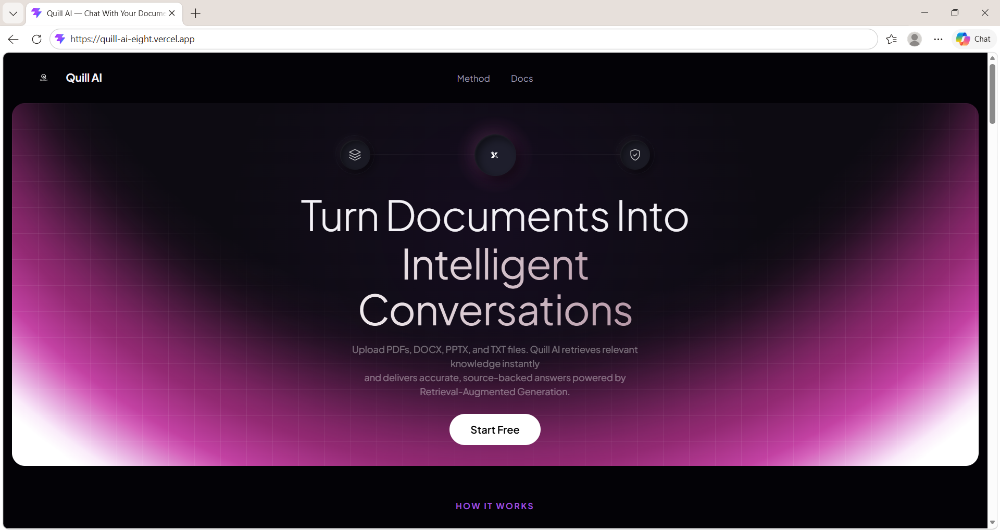
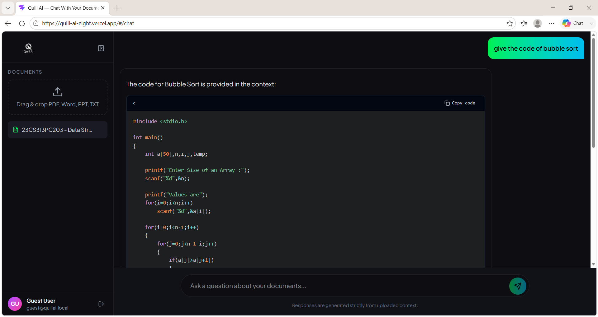
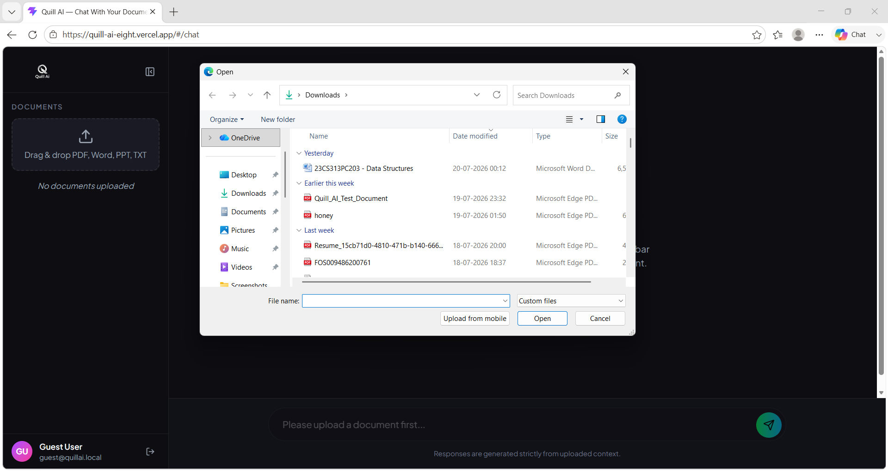
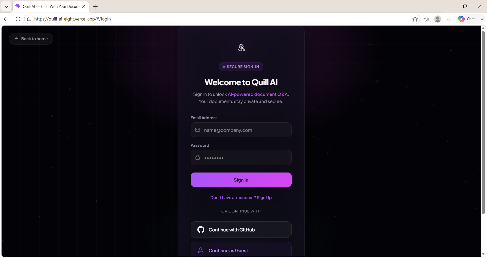
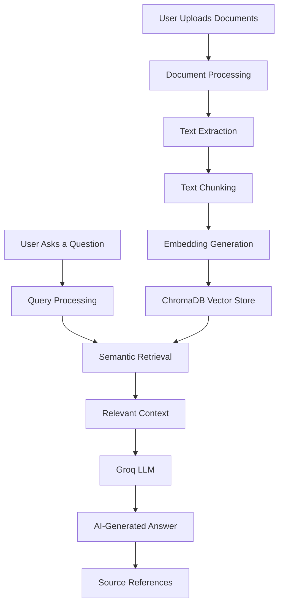

# 🪶 Quill AI

<p align="center">
  
</p>

<h1 align="center">Quill AI — Chat with Your Documents</h1>

<p align="center">
  An AI-powered document assistant that lets you upload files, ask questions, and receive intelligent answers grounded in your documents.
</p>

<p align="center">
  <a href="https://quill-ai-eight.vercel.app/">Live Demo</a> •
  <a href="#-features">Features</a> •
  <a href="#-getting-started">Getting Started</a> •
  <a href="#-contributing">Contributing</a>
</p>

<p align="center">
  
  
  
  
  
  
</p>

---

## 📌 Table of Contents

- [Overview](#-overview)
- [Screenshots](#-screenshots)
- [Features](#-features)
- [How It Works](#-how-it-works)
- [Technology Stack](#-technology-stack)
- [Project Structure](#-project-structure)
- [Getting Started](#-getting-started)
- [Environment Variables](#-environment-variables)
- [Running the Application](#-running-the-application)
- [Deployment](#-deployment)
- [Contributing](#-contributing)
- [License](#-license)
- [Acknowledgements](#-acknowledgements)

---

## 🚀 Overview

**Quill AI** is a full-stack Retrieval-Augmented Generation (RAG) application that allows users to interact with their documents through natural language conversations.

Instead of manually searching through lengthy documents, users can upload their files and ask questions. Quill AI retrieves relevant information from the uploaded content and uses an AI language model to generate context-aware responses with supporting source references.

The application combines a modern React frontend with a Python FastAPI backend, semantic search, vector storage, and large language model inference.

The goal is to make document understanding faster, more intuitive, and accessible through a conversational interface.

---

## 🖥️ Screenshots

### Landing Page

<p align="center">
  
</p>

### AI Chat Interface

<p align="center">
  
</p>

### Document Upload

<p align="center">
  
</p>

### Authentication

<p align="center">
  
</p>

---

## ✨ Features

- **Document Upload:** Upload PDF, DOCX, PPTX, and TXT documents.
- **Retrieval-Augmented Generation:** Generate answers using information retrieved from uploaded documents.
- **Semantic Search:** Find relevant document content based on meaning rather than exact keyword matching.
- **Conversational AI:** Ask questions about uploaded documents using a natural language interface.
- **Source References:** Display supporting document references to help users understand where answers come from.
- **User Authentication:** Supports authentication through Supabase, including configured sign-in options and guest access.
- **Context-Aware Responses:** Generate responses using retrieved document context.
- **Session Management:** Manage temporary document-chat sessions with automatic cleanup.
- **Upload Protection:** Apply document size and session limits to help control resource usage.
- **Responsive Interface:** Access the application through a modern, responsive web interface.
- **AI-Powered Inference:** Use Groq-powered language model inference for fast response generation.

---

## ⚙️ How It Works

Quill AI follows a Retrieval-Augmented Generation (RAG) workflow.



### Workflow Explanation

1. **Document Upload:** Users upload supported documents through the frontend.
2. **Text Extraction:** The backend extracts readable content from the uploaded files.
3. **Chunking:** Extracted text is divided into smaller, manageable chunks.
4. **Embedding Generation:** Text chunks are converted into vector representations.
5. **Vector Storage:** Embeddings and associated content are stored in ChromaDB.
6. **Question Processing:** The user's question is processed and converted into a searchable representation.
7. **Semantic Retrieval:** Relevant document chunks are retrieved from the vector database.
8. **Answer Generation:** Retrieved context is passed to the Groq-powered language model.
9. **Response Delivery:** The generated answer and supporting source references are returned to the frontend.

---

## 🛠️ Technology Stack

| Category            | Technologies                       |
| ------------------- | ---------------------------------- |
| Frontend            | React.js, Vite                     |
| Styling             | Tailwind CSS                       |
| Backend             | Python, FastAPI                    |
| API Server          | Uvicorn                            |
| Authentication      | Supabase Auth                      |
| RAG Framework       | LangChain                          |
| Embeddings          | Hugging Face Sentence Transformers |
| Vector Database     | ChromaDB                           |
| LLM Inference       | Groq                               |
| Document Processing | PyPDFium2, docx2txt, python-pptx   |
| Deployment          | Vercel, Railway                    |

---

## 📁 Project Structure

```text
Quill-AI/
│
├── backend/
│   ├── __init__.py
│   ├── main.py
│   ├── rag.py
│   └── .env.example
│
├── frontend/
│   ├── public/
│   ├── src/
│   ├── generate-env.js
│   ├── index.html
│   ├── package.json
│   ├── package-lock.json
│   ├── vite.config.js
│   └── README.md
│
├── temp/
│
├── .gitignore
├── README.md
├── LICENSE
├── requirements.txt
├── run-tunnel.js
├── vercel.json
│
├── landing.png
├── chat.png
├── upload.png
└── auth.png
```

---

## 💻 Getting Started

Follow these instructions to run Quill AI locally.

### Prerequisites

Make sure the following tools are installed:

- [Python](https://www.python.org/downloads/)
- [Node.js](https://nodejs.org/)
- [Git](https://git-scm.com/)
- A [Groq API Key](https://console.groq.com/)
- A [Supabase Project](https://supabase.com/)

### 1. Clone the Repository

```bash
git clone https://github.com/Gagan3287/Quill-AI.git
```

Navigate into the project:

```bash
cd Quill-AI
```

### 2. Configure the Backend

Create a Python virtual environment:

**Windows:**

```powershell
python -m venv venv
.\venv\Scripts\Activate.ps1
```

**macOS / Linux:**

```bash
python3 -m venv venv
source venv/bin/activate
```

Install the backend dependencies from the repository root:

```bash
pip install -r requirements.txt
```

Create your backend environment file by copying the example:

**Windows PowerShell:**

```powershell
Copy-Item backend\.env.example .env
```

**macOS / Linux:**

```bash
cp backend/.env.example .env
```

Open the newly created `.env` file and add your Groq API key.

### 3. Configure the Frontend

Navigate to the frontend directory:

```bash
cd frontend
```

Install the dependencies:

```bash
npm install
```

Create a `.env.local` file inside the `frontend/` directory and configure your Supabase credentials and backend API URL.

```env
VITE_SUPABASE_URL=your_supabase_project_url
VITE_SUPABASE_ANON_KEY=your_supabase_anon_key
VITE_API_URL=http://localhost:8000/api
```

Return to the repository root when you are ready to start the backend.

---

## 🔐 Environment Variables

### Backend Configuration

The backend reads its configuration from environment variables.

| Variable                         | Description                           | Default     |
| -------------------------------- | ------------------------------------- | ----------- |
| `GROQ_API_KEY`                   | API key used for Groq inference       | Required    |
| `ALLOWED_ORIGINS`                | Allowed frontend origins for CORS     | `*`         |
| `CHROMA_PATH`                    | ChromaDB storage directory            | `chroma_db` |
| `SIMILARITY_THRESHOLD`           | Similarity filtering threshold        | `1.5`       |
| `MAX_UPLOAD_BYTES`               | Maximum document upload size in bytes | `20971520`  |
| `MAX_DOCS_PER_SESSION`           | Maximum documents per session         | `8`         |
| `MAX_CONCURRENT_UPLOADS`         | Maximum concurrent uploads            | `2`         |
| `SESSION_IDLE_TTL_SECONDS`       | Session idle timeout in seconds       | `1200`      |
| `SESSION_SWEEP_INTERVAL_SECONDS` | Session cleanup interval in seconds   | `300`       |

### Frontend Configuration

| Variable                 | Description              |
| ------------------------ | ------------------------ |
| `VITE_SUPABASE_URL`      | Supabase project URL     |
| `VITE_SUPABASE_ANON_KEY` | Supabase public anon key |
| `VITE_API_URL`           | Backend API URL          |

**Important:**

- Never commit your `.env` or `.env.local` files.
- Do not expose your Groq API key in frontend code.
- Use the Supabase public anon key in the frontend and configure appropriate Supabase security policies.
- Keep production credentials in your deployment platform's environment settings.

---

## ▶️ Running the Application

Quill AI requires the backend and frontend to run separately during local development.

### Start the Backend

From the repository root, activate your virtual environment and run:

```bash
uvicorn backend.main:app --reload --host 0.0.0.0 --port 8000
```

The backend should be available at:

```text
http://localhost:8000
```

### Start the Frontend

Open another terminal:

```bash
cd frontend
npm run dev
```

The frontend should be available at:

```text
http://localhost:5173
```

Open the frontend URL in your browser to start using Quill AI.

---

## ☁️ Deployment

Quill AI can be deployed using separate frontend and backend hosting services.

### Frontend — Vercel

1. Import the GitHub repository into Vercel.
2. Set the project root directory to `frontend`.
3. Configure the frontend environment variables.
4. Deploy the application.

Configure:

```env
VITE_SUPABASE_URL=your_supabase_project_url
VITE_SUPABASE_ANON_KEY=your_supabase_anon_key
VITE_API_URL=https://your-backend-domain.com/api
```

### Backend — Railway

1. Create a new Railway project.
2. Connect your GitHub repository.
3. Configure the backend environment variables.
4. Set the appropriate Python dependencies and start command.
5. Deploy the backend service.

Use the following start command if deploying from the repository root:

```bash
uvicorn backend.main:app --host 0.0.0.0 --port $PORT
```

Configure `ALLOWED_ORIGINS` with your deployed frontend domain rather than leaving it open in production.

**Deployment Note:** Make sure the backend has persistent storage configured if you need ChromaDB data to survive service restarts. Configure the storage path using `CHROMA_PATH`.

---

## 🤝 Contributing

Contributions, suggestions, and improvements are welcome!

To contribute:

1. Fork the repository.
2. Create a new feature branch.

   ```bash
   git checkout -b feature/your-feature-name
   ```

3. Make your changes.
4. Test your changes locally.
5. Commit your work.

   ```bash
   git add .
   git commit -m "Add: describe your changes"
   ```

6. Push your branch.

   ```bash
   git push origin feature/your-feature-name
   ```

7. Open a Pull Request describing your changes.

Please keep contributions focused, maintain readable code, and include relevant details when reporting bugs or proposing improvements.

---

## 📄 License

This project is licensed under the **MIT License**.

See the [LICENSE](LICENSE) file for more information.

---

## 🙏 Acknowledgements

Quill AI is built using several excellent open-source tools and services.

Special thanks to the communities and developers behind:

- [React](https://react.dev/)
- [Vite](https://vite.dev/)
- [FastAPI](https://fastapi.tiangolo.com/)
- [LangChain](https://www.langchain.com/)
- [ChromaDB](https://www.trychroma.com/)
- [Hugging Face](https://huggingface.co/)
- [Groq](https://groq.com/)
- [Supabase](https://supabase.com/)
- [Tailwind CSS](https://tailwindcss.com/)

---

<p align="center">
  Made with ❤️ using AI, Python, and React.
</p>

<p align="center">
  <strong>Quill AI — Turn your documents into conversations.</strong>
</p>
